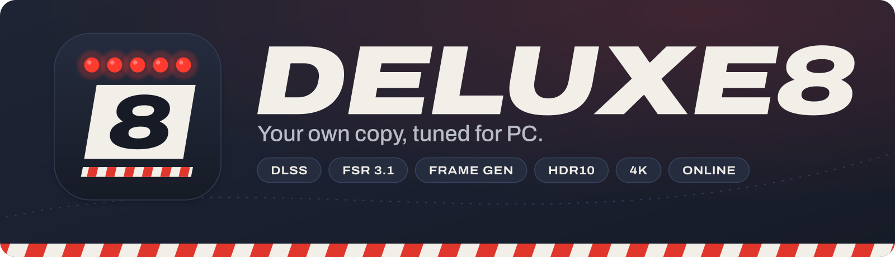
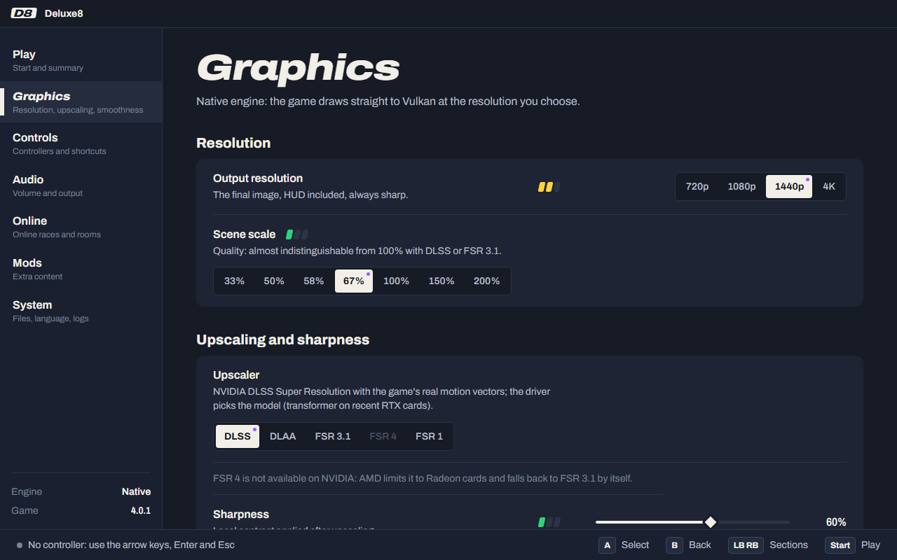
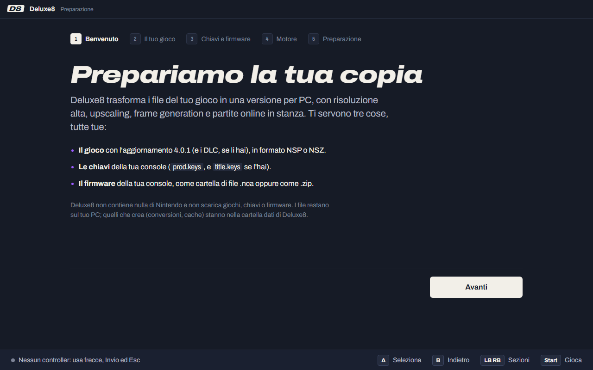
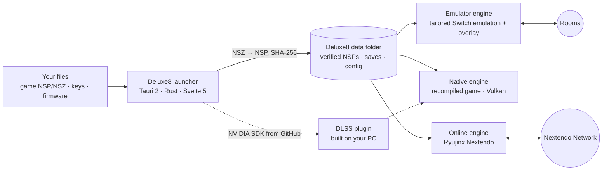

<p align="center">
  
</p>

<p align="center">
  <a href="https://github.com/iCosiSenpai/Deluxe8/releases"></a>
  <a href="https://github.com/iCosiSenpai/Deluxe8/actions/workflows/ci.yml"></a>
  
  <a href="LICENSE"></a>
</p>

<p align="center">
  
  
  
  
  
  
  
  
</p>

<h3 align="center">A tailored PC runtime for your own copy of Mario Kart 8 Deluxe.</h3>

<p align="center">
  Three engines behind one launcher: a tuned <b>emulator</b> with online rooms, the game <b>recompiled</b> for your CPU with<br>
  <b>DLSS</b>, <b>FSR 3.1</b>, <b>frame generation</b> and <b>HDR10</b>, and <b>online races</b> with players everywhere on the Nextendo Network.<br>
  Set up once, then just press <b>Play</b>.
</p>

<p align="center">
  <a href="#-highlights">Highlights</a> ·
  <a href="#-screenshots">Screenshots</a> ·
  <a href="#-quick-start">Quick start</a> ·
  <a href="#%EF%B8%8F-three-engines">Engines</a> ·
  <a href="#-online-play">Online</a> ·
  <a href="#-graphics">Graphics</a> ·
  <a href="#%EF%B8%8F-building-from-source">Build</a> ·
  <a href="#-faq">FAQ</a> ·
  <a href="#%EF%B8%8F-license-copyright-and-trademarks">License</a>
</p>

> [!IMPORTANT]
> **Bring your own game.** Deluxe8 contains nothing from Nintendo and never downloads games, keys or firmware. You need
> your own console and your own copy of the game (base game, update **4.0.1**, optionally the Booster Course Pass), plus
> the keys and firmware dumped from that console. Deluxe8 never connects to Nintendo's servers.

## ✨ Highlights

<table>
  <tr>
    <td width="33%" valign="top">
      <h4>🏁 Five-step setup</h4>
      Point it at your game folder: NSZ packages become verified NSPs (SHA-256 of every NCA), keys and firmware are
      checked, the engine is prepared once. Your original files are never moved or modified.
    </td>
    <td width="33%" valign="top">
      <h4>🟩 DLSS, DLAA, FSR 3.1</h4>
      Real temporal upscaling with the game's own motion vectors in the Native engine. DLSS is built on your PC from
      NVIDIA's public SDK: nothing from NVIDIA is redistributed.
    </td>
    <td width="33%" valign="top">
      <h4>🎞️ Frame generation</h4>
      DLSS Frame Generation and FSR 3 (2x), a built-in interpolator (2x to 4x) or your own Lossless Scaling. Tested at
      60 fps game / 120 fps on screen.
    </td>
  </tr>
  <tr>
    <td valign="top">
      <h4>🌍 Online, with anyone</h4>
      Worldwide races, tournaments and friends on the community-run Nextendo Network, against players on consoles and
      other emulators; or rooms for local wireless races over the internet.
    </td>
    <td valign="top">
      <h4>🖥️ Up to 4K and beyond</h4>
      720p to 4K output with a separate 3D scene scale (33 % to 200 %), or 0.5x to 8x internal resolution in the
      Emulator. HDR10 with tone mapping from the game's own HDR scene.
    </td>
    <td valign="top">
      <h4>🎮 Controller first</h4>
      The whole launcher works with a gamepad (D-pad, A/B, LB/RB, Start). In game, <kbd>L3</kbd>+<kbd>R3</kbd> (or
      <kbd>F1</kbd>) opens an overlay to tweak graphics, volume and rooms without leaving the race.
    </td>
  </tr>
  <tr>
    <td valign="top">
      <h4>🧩 Mods and patches</h4>
      Toggle RomFS/ExeFS mods per title. Optional 60 fps for 3-4 player split screen (update 4.0.1).
    </td>
    <td valign="top">
      <h4>🔒 Verified downloads</h4>
      Every component the launcher fetches (Native engine, DLSS SDK, Ryujinx Nextendo) is pinned by URL, size and
      SHA-256. Releases come with checksums and build provenance.
    </td>
    <td valign="top">
      <h4>🌐 English and Italian</h4>
      The interface speaks English, and Italian when your PC is set to Italian or you live in Italy; switch any time
      in <i>System</i>. The in-game overlay follows along.
    </td>
  </tr>
</table>

## 📸 Screenshots

<table>
  <tr>
    <td></td>
    <td></td>
  </tr>
  <tr>
    <td></td>
    <td></td>
  </tr>
</table>

<sub>The launcher only, with sample data: no game footage.</sub>

## 🚀 Quick start

1. **Download** the latest installer from [Releases](https://github.com/iCosiSenpai/Deluxe8/releases) (Windows,
   per-user install, no administrator rights) and check it against `SHA256SUMS.txt`. Linux: the experimental `.deb`
   (Ubuntu 26.04) or AppImage, when the release has one.
2. **Dump your own files** from your console: the game and its update as NSP or NSZ, `prod.keys` (and `title.keys`),
   and the firmware as a folder of `.nca` files or a `.zip`.
3. **Run Deluxe8.** The setup wizard finds files that other emulators on your PC already know about, checks everything
   and prepares the game. The Native engine also compiles the game for your CPU: about 4 minutes on the test PC
   (Core Ultra 7 265K).
4. **Pick an engine and press Play.** Change graphics any time, from the launcher or the in-game overlay. For online
   races, follow the four steps on the *Online* page.

> [!TIP]
> On an NVIDIA RTX card, turn on **DLSS** in the setup's engine step (or later in *System → Components*). The launcher
> downloads NVIDIA's SDK straight from [github.com/NVIDIA/DLSS](https://github.com/NVIDIA/DLSS), shows you its licence,
> and compiles the plugin for your PC with the Native engine's own toolchain. No Visual Studio needed.

## 🏎️ Three engines

| | **Emulator** | **Native** | **Online** |
|---|---|---|---|
| **What it is** | a Nintendo Switch emulator tailored to this one game, with Deluxe8's in-game overlay | the game's own code recompiled into a PC program for your CPU (static recompilation) | Ryujinx Nextendo, the emulator built for the Nextendo Network |
| **Best for** | compatibility, mods, rooms with friends | image quality and frame pacing | online races with everyone |
| **Resolution** | 0.5x to 8x internal resolution | 720p to 4K output, 33 % to 200 % scene scale | set in Ryujinx (up to 4x and more) |
| **Upscaling** | FSR 1, Snapdragon GSR, ScaleForce, Lanczos, … + SMAA/FXAA | DLSS / DLAA, FSR 3.1, FSR 4 (Radeon), FSR 1 | FSR 1, area, bilinear (Ryujinx) |
| **Frame generation** | Lossless Scaling (your copy) | DLSS FG, FSR 3, built-in 2x to 4x | — |
| **HDR10** | — | ✅ | — |
| **Online** | ✅ rooms: local wireless and LAN over the internet, also with Eden, Citron and suyu players | ❌ not yet (the upstream engine ships without networking) | ✅ the Nextendo Network: worldwide races, tournaments, friends, with consoles and other emulators |
| **In-game menu** | Deluxe8 overlay (<kbd>L3</kbd>+<kbd>R3</kbd> / <kbd>F1</kbd>) | the engine's menu (<kbd>F10</kbd> / <kbd>L3</kbd>+<kbd>R3</kbd>) | the game's own menus; Ryujinx's window for settings |
| **Comes from** | built from source, shipped in the installer | downloaded by the launcher from its GitHub release (pinned, verified) | downloaded by the launcher from the Nextendo team (pinned, verified) |

Switch engines any time from the *Play* screen: they share the same prepared game files, so nothing is converted twice.

## 🌍 Online play

You do not need Deluxe8 to race against a Deluxe8 player, and nobody needs a console account from Nintendo.

| | **Nextendo Network** (Online engine) | **Rooms** (Emulator engine) |
|---|---|---|
| **In the game** | *Online play*: worldwide and regional races, tournaments, friends, time-trial ghosts | *Wireless play* (up to 8) or *LAN play* (up to 12) |
| **You race with** | players on the Nextendo builds of Ryujinx and Citron, and on consoles running Nextendo's Prelude (custom firmware) | players on Deluxe8 and on yuzu-family emulators: Eden, Citron, suyu, Sudachi (same room protocol) |
| **Needs** | a free Nextendo account (created on [nextendo.network](https://nextendo.network)) | a driver name; the host's port reachable (the launcher opens it with UPnP) |
| **Servers** | Nextendo Network, run by volunteers | the public room lobby, or your own room |

**Nextendo Network in four steps** (the *Online* page walks you through them):

1. Deluxe8 downloads **Ryujinx Nextendo** (42 MB, checked by SHA-256) and puts your game, update, DLC, keys and
   firmware where it reads them.
2. Create a free account on [nextendo.network](https://nextendo.network).
3. *Sign in*: Deluxe8 opens Ryujinx Nextendo; link the account under *Settings › Nextendo*. Deluxe8 never sees your
   password.
4. *Play online*: the game starts with your update and DLC; choose *Online play* in its menu.

[Nextendo Network](https://nextendo.network) is an independent community project, not affiliated with Deluxe8 or with
Nintendo. Details on both ways to play: [docs/ONLINE.md](docs/ONLINE.md).

## 🎨 Graphics

Temporal upscalers and in-engine frame generation need per-pixel motion vectors, depth and a jittered camera. An
emulator only sees the console GPU's command stream, so the Emulator engine offers spatial filters and optical-flow frame
generation; the Native engine draws the game itself in Vulkan and feeds DLSS and FSR the real data.

**Measured on an RTX 5070 Ti** (driver 621.01, update 4.0.1, a race at 1440p): DLSS Super Resolution at 67 %
(1707×960 → 2560×1440) plus DLSS Frame Generation holds **60 fps game speed, 120 fps on screen**, with 1.3 ms of GPU
time for upscaling and no visible ghosting. The Emulator engine runs the same update with the Booster Course Pass at
60 fps, and Ryujinx Nextendo boots it with the update and DLC on the same card.

Everything, with sources and caveats (FSR 4 on non-Radeon cards, NVIDIA Smooth Motion, Lossless Scaling):
[docs/GRAPHICS.md](docs/GRAPHICS.md).

## 🧭 How it works



More in [docs/ARCHITECTURE.md](docs/ARCHITECTURE.md): data folder layout, the launcher ↔ engine contract, telemetry,
pinned downloads.

## 🛠️ Building from source

Windows (Visual Studio 2022 or 2026 with the C++ workload; no administrator rights needed):

```powershell
pwsh tools/engine.ps1 all          # Emulator engine: LLVM, CMake, glslang (pinned) + Eden + patches -> out/engine/win-x64
cd apps/launcher
pnpm install
pnpm tauri dev                     # or: pnpm tauri build --config src-tauri/tauri.bundle-windows.conf.json
```

Linux: `tools/engine.sh all` (packages in [docs/BUILDING.md](docs/BUILDING.md)), then the same launcher commands with
`tauri.bundle-linux.conf.json`. Signed release builds: [docs/RELEASING.md](docs/RELEASING.md).

<details>
<summary><b>Project layout</b></summary>

```text
apps/launcher/        Tauri 2 launcher: Rust backend (src-tauri) + Svelte 5 UI (src), English and Italian
crates/nx/            d8-nx: PFS0, CNMT, NSZ -> NSP with SHA-256 checks, keys and firmware inspection
engine/               the Emulator engine: Eden pin (upstream.json), our patch queue (patches/), our code (src/deluxe8)
tools/                engine.ps1 / engine.sh, native.ps1, release.ps1, brand.py
docs/                 architecture, building, graphics, online, legal, releasing
```

</details>

## ❓ FAQ

<details>
<summary><b>Can I race friends who don't use Deluxe8?</b></summary>

Yes. On the Nextendo Network you meet players on Ryujinx Nextendo, Citron Nextendo and consoles with Prelude. In rooms,
anyone with a yuzu-family emulator (Eden, Citron, suyu, Sudachi) can join with the room's address. Everybody needs the
same game version (4.0.1).
</details>

<details>
<summary><b>Is this legal?</b></summary>

Deluxe8 is a launcher and a set of patches to open-source projects. It ships no Nintendo code or content, and it only
works with files you dumped from hardware you own. Laws on dumping and decryption differ by country: check yours. See
[docs/LEGAL.md](docs/LEGAL.md).
</details>

<details>
<summary><b>Windows says "Windows protected your PC" or my antivirus complains.</b></summary>

New programs need download reputation before SmartScreen trusts them, even when they are code-signed. Check the
installer against `SHA256SUMS.txt` from the same release (and its build provenance with
`gh attestation verify <file> --repo iCosiSenpai/Deluxe8`), then choose *More info → Run anyway*. False positives can
be reported to your antivirus vendor; see [docs/RELEASING.md](docs/RELEASING.md#antivirus-false-positives).
</details>

<details>
<summary><b>Does it work with other games?</b></summary>

No. Every part of Deluxe8 is tuned for Mario Kart 8 Deluxe (title `0100152000022000`), update 4.0.1.
</details>

<details>
<summary><b>Where is my data, and how do I remove everything?</b></summary>

Settings, converted packages, saves and downloads live in `%LOCALAPPDATA%\Deluxe8\data` on Windows and
`~/.local/share/deluxe8` on Linux (or `DELUXE8_DATA_DIR`). Uninstalling keeps that folder so your saves survive a
reinstall; delete it by hand to remove everything.
</details>

<details>
<summary><b>Why is DLSS greyed out?</b></summary>

DLSS needs an NVIDIA RTX card and the Native engine. If the plugin is missing, install it from *System → Components*.
</details>

## 🙏 Credits

Deluxe8 stands on the shoulders of [Eden](https://git.eden-emu.dev/eden-emu/eden) and the yuzu family of emulators,
[Racing 8 DX Recomp](https://github.com/galarianpikachu2021-hue/Racing-8-DX-Recomp), [Ryujinx](https://github.com/Ryubing/Ryujinx)
and the [Nextendo Network](https://nextendo.network) team, [Dear ImGui](https://github.com/ocornut/imgui),
[Tauri](https://tauri.app), [Svelte](https://svelte.dev), AMD [FidelityFX](https://gpuopen.com/fidelityfx-super-resolution-3/)
and the [Archivo](https://github.com/Omnibus-Type/Archivo) typeface by Omnibus-Type. NVIDIA DLSS and Lossless Scaling
are used from the player's own downloads and are never redistributed.

## ⚖️ License, copyright and trademarks

**Deluxe8** — Copyright © 2026 Deluxe8 contributors. Free software under the
[GNU General Public License v3.0 or later](LICENSE): you may run, study, share and modify it; derived works must stay
under the same licence and come with their source.

**Third-party components** (full list and how each is used: [docs/LEGAL.md](docs/LEGAL.md)):

| Component | Copyright | Licence | In Deluxe8 |
|---|---|---|---|
| Eden (yuzu / sudachi lineage) | © Eden Emulator Project, © yuzu Emulator Project and contributors | GPL-3.0-or-later | Emulator engine, shipped with our patches (`LICENSE-eden.txt` installed beside it) |
| Racing 8 DX Recomp (suyu lineage) | © its authors and contributors | GPL-3.0 | Native engine, downloaded by the launcher |
| Ryujinx Nextendo | © Ryujinx Team and contributors, © Nextendo Network contributors | MIT | Online engine, downloaded by the launcher |
| Dear ImGui | © Omar Cornut | MIT | in-game overlay |
| Archivo | © The Archivo Project Authors (Omnibus-Type) | SIL OFL 1.1 | interface and overlay typeface (`OFL.txt` installed with it) |
| Tauri | © Tauri Programme within The Commons Conservancy | MIT / Apache-2.0 | launcher framework |
| Svelte | © Svelte contributors | MIT | launcher interface |
| AMD FidelityFX (FSR) | © Advanced Micro Devices, Inc. | MIT | Native engine plugins |
| NVIDIA DLSS SDK | © NVIDIA Corporation | NVIDIA DLSS SDK licence | **not distributed**: downloaded by the player from NVIDIA's GitHub and compiled on their PC |
| Vulkan headers | © The Khronos Group Inc. | Apache-2.0 / MIT | downloaded with the DLSS SDK to build the plugin |
| Lossless Scaling | © THS | proprietary | **not distributed**: the player's own Steam copy |

**Trademarks.** Nintendo, Nintendo Switch, Mario Kart and Mario Kart 8 Deluxe are trademarks of Nintendo; the game,
its characters, tracks, music and artwork are © Nintendo. NVIDIA, GeForce RTX and DLSS are trademarks of NVIDIA
Corporation. AMD, Radeon and FidelityFX are trademarks of Advanced Micro Devices, Inc. Vulkan is a registered trademark
of The Khronos Group Inc. Windows is a trademark of Microsoft Corporation; Linux is a registered trademark of Linus
Torvalds; Steam is a trademark of Valve Corporation. All other names are trademarks of their respective owners and are
used only to say what Deluxe8 works with.

**No affiliation.** Deluxe8 is an independent, non-commercial project. It is not affiliated with, endorsed, sponsored or
approved by Nintendo, NVIDIA, AMD, the Khronos Group, Valve, or the Nextendo Network. It contains no Nintendo code, keys,
firmware, game data or artwork: its name, logo and graphics are its own.

<p align="center">
  <a href="https://star-history.com/#iCosiSenpai/Deluxe8&Date">
    
  </a>
</p>

<p align="center"><br><sub>Made for racing nights.</sub></p>
