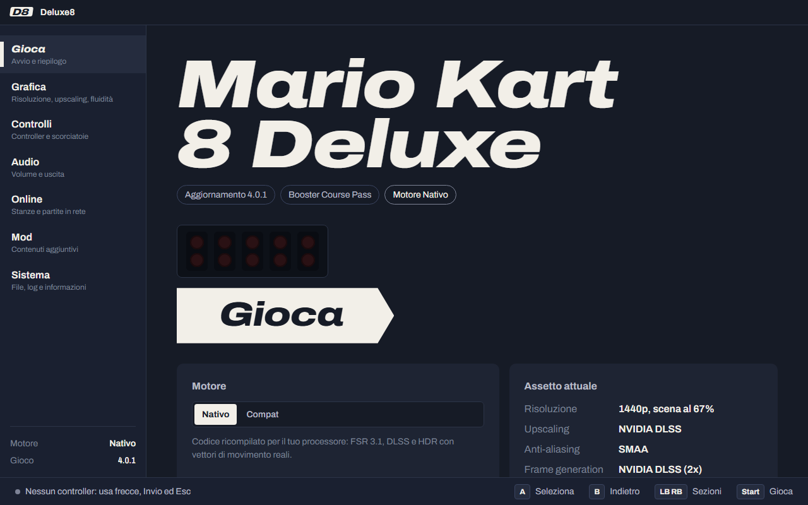
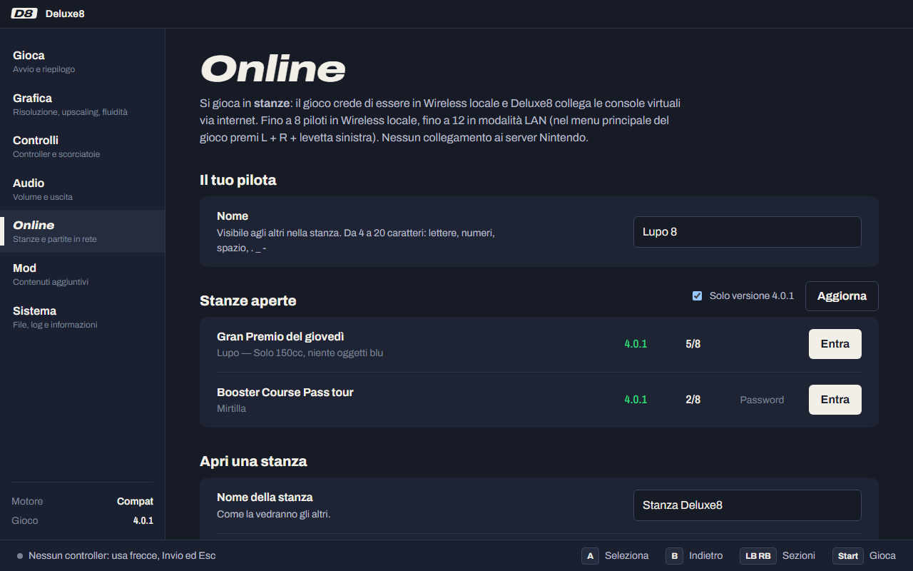
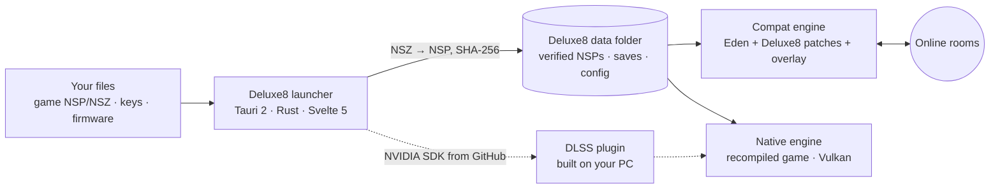
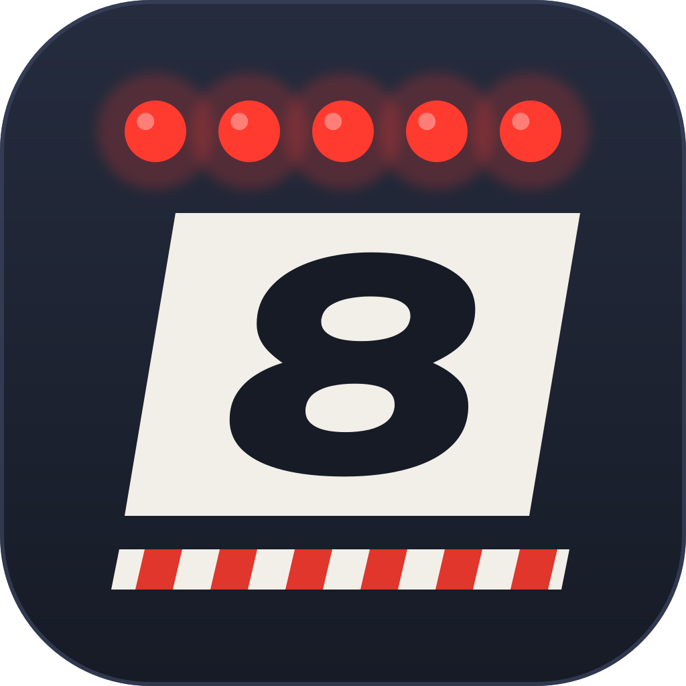

<p align="center">
  
</p>

<p align="center">
  <a href="https://github.com/iCosiSenpai/Deluxe8/releases"></a>
  <a href="https://github.com/iCosiSenpai/Deluxe8/actions/workflows/ci.yml"></a>
  
  <a href="LICENSE"></a>
</p>

<p align="center">
  
  
  
  
  
  
  
</p>

<h3 align="center">A tailored PC runtime for your own copy of Mario Kart 8 Deluxe.</h3>

<p align="center">
  Two engines behind one launcher: a tuned emulation core with online rooms, or the game's code<br>
  recompiled for your CPU with <b>DLSS</b>, <b>FSR 3.1</b>, <b>frame generation</b> and <b>HDR10</b>. Set up once, then just press <b>Play</b>.
</p>

<p align="center">
  <a href="#-highlights">Highlights</a> ·
  <a href="#-screenshots">Screenshots</a> ·
  <a href="#-quick-start">Quick start</a> ·
  <a href="#%EF%B8%8F-two-engines">Engines</a> ·
  <a href="#-graphics">Graphics</a> ·
  <a href="#-online-rooms">Online</a> ·
  <a href="#%EF%B8%8F-building-from-source">Build</a> ·
  <a href="#-faq">FAQ</a>
</p>

> [!IMPORTANT]
> **Bring your own game.** Deluxe8 contains nothing from Nintendo and never downloads games, keys or firmware. You need
> your own console and your own copy of the game (base game, update **4.0.1**, optionally the Booster Course Pass), plus
> the keys and firmware dumped from that console. Deluxe8 never connects to Nintendo's servers.

## ✨ Highlights

<table>
  <tr>
    <td width="33%" valign="top">
      <h4>🏁 Five-step setup</h4>
      Point it at your game folder: NSZ packages become verified NSPs (SHA-256 of every NCA), keys and firmware are
      checked, the engine is prepared once. Your original files are never moved or modified.
    </td>
    <td width="33%" valign="top">
      <h4>🟩 DLSS, DLAA, FSR 3.1</h4>
      Real temporal upscaling with the game's own motion vectors in the Native engine. DLSS is built on your PC from
      NVIDIA's public SDK: nothing from NVIDIA is redistributed.
    </td>
    <td width="33%" valign="top">
      <h4>🎞️ Frame generation</h4>
      DLSS Frame Generation and FSR 3 (2x), a built-in interpolator (2x to 4x) or your own Lossless Scaling. Tested at
      60 fps game / 120 fps on screen.
    </td>
  </tr>
  <tr>
    <td valign="top">
      <h4>🖥️ Up to 4K and beyond</h4>
      720p to 4K output with a separate 3D scene scale (33 % to 200 %), or 0.5x to 8x internal resolution in the Compat
      engine. HDR10 with tone mapping from the game's HDR scene.
    </td>
    <td valign="top">
      <h4>🌐 Online rooms</h4>
      Local wireless and LAN races over the internet: browse public rooms, host your own with automatic UPnP port
      forwarding, password-protect it. Up to 8 players (12 in LAN mode).
    </td>
    <td valign="top">
      <h4>🎮 Controller first</h4>
      The whole launcher works with a gamepad (D-pad, A/B, LB/RB, Start). In game, <kbd>L3</kbd>+<kbd>R3</kbd> (or
      <kbd>F1</kbd>) opens an overlay to tweak graphics, volume and rooms without leaving the race.
    </td>
  </tr>
  <tr>
    <td valign="top">
      <h4>🧩 Mods and patches</h4>
      Toggle RomFS/ExeFS mods per title. Optional 60 fps for 3-4 player split screen (update 4.0.1).
    </td>
    <td valign="top">
      <h4>🔒 Verified downloads</h4>
      Every component the launcher fetches is pinned by URL, size and SHA-256. Builds come with checksums and
      build provenance.
    </td>
    <td valign="top">
      <h4>🐧 Windows and Linux</h4>
      One codebase, x86-64 on both. Windows is the tested platform today; Linux packages (AppImage, deb) are in progress.
    </td>
  </tr>
</table>

## 📸 Screenshots

<table>
  <tr>
    <td></td>
    <td></td>
  </tr>
  <tr>
    <td></td>
    <td></td>
  </tr>
</table>

<sub>The launcher only, with sample data: no game footage. The interface is currently in Italian; English is planned.</sub>

## 🚀 Quick start

1. **Download** the latest installer from [Releases](https://github.com/iCosiSenpai/Deluxe8/releases) (Windows,
   per-user install, no administrator rights) and check it against `SHA256SUMS.txt`.
2. **Dump your own files** from your console: the game and its update as NSP or NSZ, `prod.keys` (and `title.keys`),
   and the firmware as a folder of `.nca` files or a `.zip`.
3. **Run Deluxe8.** The setup wizard finds files that other emulators on your PC already know about, checks everything
   and prepares the game. The Native engine also compiles the game for your CPU: about 4 minutes on the test PC
   (Core Ultra 7 265K).
4. **Pick an engine and press Play.** Change graphics any time, from the launcher or the in-game overlay.

> [!TIP]
> On an NVIDIA RTX card, turn on **DLSS** in the setup's engine step (or later in *Sistema → Componenti*). The launcher
> downloads NVIDIA's SDK straight from [github.com/NVIDIA/DLSS](https://github.com/NVIDIA/DLSS), shows you its licence,
> and compiles the plugin for your PC with the Native engine's own toolchain. No Visual Studio needed.

## 🏎️ Two engines

| | **Compat** | **Native** |
|---|---|---|
| **What it is** | [Eden](https://git.eden-emu.dev/eden-emu/eden), the Switch emulator, tailored by our patch queue | static recompilation of the game's ARM64 code to x86-64 ([Racing 8 DX Recomp](https://github.com/galarianpikachu2021-hue/Racing-8-DX-Recomp)) |
| **Best for** | compatibility, online rooms, mods | image quality and frame pacing |
| **Resolution** | 0.5x to 8x internal resolution | 720p to 4K output, 33 % to 200 % scene scale |
| **Upscaling** | FSR 1, Snapdragon GSR, ScaleForce, Lanczos, … + SMAA/FXAA | DLSS / DLAA, FSR 3.1, FSR 4 (Radeon), FSR 1 |
| **Frame generation** | Lossless Scaling (your copy) | DLSS FG, FSR 3, built-in 2x to 4x |
| **HDR10** | — | ✅ |
| **Online rooms** | ✅ | — |
| **In-game menu** | Deluxe8 overlay (<kbd>L3</kbd>+<kbd>R3</kbd> / <kbd>F1</kbd>) | the engine's menu (<kbd>F10</kbd> / <kbd>L3</kbd>+<kbd>R3</kbd>) |
| **Comes from** | built from source and shipped in the installer | downloaded by the launcher from its GitHub release (pinned, verified) |

## 🎨 Graphics

Temporal upscalers and in-engine frame generation need per-pixel motion vectors, depth and a jittered camera. An
emulator only sees the console GPU's command stream, so the Compat engine offers spatial filters and optical-flow frame
generation; the Native engine draws the game itself in Vulkan and feeds DLSS and FSR the real data.

**Measured on an RTX 5070 Ti** (driver 621.01, update 4.0.1, a race at 1440p): DLSS Super Resolution at 67 %
(1707×960 → 2560×1440) plus DLSS Frame Generation holds **60 fps game speed, 120 fps on screen**, with 1.3 ms of GPU
time for upscaling and no visible ghosting. The Compat engine runs the same update with the Booster Course Pass at
60 fps.

Everything, with sources and caveats (FSR 4 on non-Radeon cards, NVIDIA Smooth Motion, Lossless Scaling):
[docs/GRAPHICS.md](docs/GRAPHICS.md).

## 🌐 Online rooms

The game thinks it is playing in *local wireless* or *LAN* mode; Deluxe8 connects the virtual consoles over the
internet through a room server. Browse the public lobby, filter rooms by game version, join with a password, or host
your own room with one click (the launcher asks your router to open the port through UPnP and closes it again when you
stop). Everyone in a room must run the same game version. Details: [docs/ONLINE.md](docs/ONLINE.md).

## 🧭 How it works



More in [docs/ARCHITECTURE.md](docs/ARCHITECTURE.md): data folder layout, the launcher ↔ engine contract, telemetry,
pinned downloads.

## 🛠️ Building from source

Windows (Visual Studio 2022 or 2026 with the C++ workload; no administrator rights needed):

```powershell
pwsh tools/engine.ps1 all          # Compat engine: LLVM, CMake, glslang (pinned) + Eden + patches -> out/engine/win-x64
cd apps/launcher
pnpm install
pnpm tauri dev                     # or: pnpm tauri build --config src-tauri/tauri.bundle-windows.conf.json
```

Linux: `tools/engine.sh all` (packages in [docs/BUILDING.md](docs/BUILDING.md)), then the same launcher commands with
`tauri.bundle-linux.conf.json`. Signed release builds: [docs/RELEASING.md](docs/RELEASING.md).

<details>
<summary><b>Project layout</b></summary>

```text
apps/launcher/        Tauri 2 launcher: Rust backend (src-tauri) + Svelte 5 UI (src)
crates/nx/            d8-nx: PFS0, CNMT, NSZ -> NSP with SHA-256 checks, keys and firmware inspection
engine/               Eden pin (upstream.json), our patch queue (patches/) and our own code (src/deluxe8: overlay, telemetry)
tools/                engine.ps1 / engine.sh (Compat engine), native.ps1 (Native engine from source), release.ps1, brand.py
docs/                 architecture, building, graphics, online, legal, releasing
```

</details>

## ❓ FAQ

<details>
<summary><b>Is this legal?</b></summary>

Deluxe8 is a launcher and a set of patches to open-source projects. It ships no Nintendo code or content, and it only
works with files you dumped from hardware you own. Laws on dumping and decryption differ by country: check yours. See
[docs/LEGAL.md](docs/LEGAL.md).
</details>

<details>
<summary><b>Windows says "Windows protected your PC" or my antivirus complains.</b></summary>

New programs need download reputation before SmartScreen trusts them, even when they are code-signed. Check the
installer against `SHA256SUMS.txt` from the same release (and its build provenance with
`gh attestation verify <file> --repo iCosiSenpai/Deluxe8`), then choose *More info → Run anyway*. False positives can
be reported to your antivirus vendor; see [docs/RELEASING.md](docs/RELEASING.md#antivirus-false-positives).
</details>

<details>
<summary><b>Does it work with other games?</b></summary>

No. Every part of Deluxe8 is tuned for Mario Kart 8 Deluxe (title `0100152000022000`), update 4.0.1.
</details>

<details>
<summary><b>Where is my data, and how do I remove everything?</b></summary>

Settings, converted packages, saves and downloads live in `%LOCALAPPDATA%\Deluxe8\data` on Windows and
`~/.local/share/deluxe8` on Linux (or `DELUXE8_DATA_DIR`). Uninstalling keeps that folder so your saves survive a
reinstall; delete it by hand to remove everything.
</details>

<details>
<summary><b>Why is DLSS greyed out?</b></summary>

DLSS needs an NVIDIA RTX card and the Native engine. If the plugin is missing, install it from *Sistema → Componenti*.
</details>

## 🙏 Credits

Deluxe8 stands on the shoulders of [Eden](https://git.eden-emu.dev/eden-emu/eden) and the yuzu family of emulators,
[Racing 8 DX Recomp](https://github.com/galarianpikachu2021-hue/Racing-8-DX-Recomp), [Dear ImGui](https://github.com/ocornut/imgui),
[Tauri](https://tauri.app), [Svelte](https://svelte.dev), AMD [FidelityFX](https://gpuopen.com/fidelityfx-super-resolution-3/)
and the [Archivo](https://github.com/Omnibus-Type/Archivo) typeface by Omnibus-Type. NVIDIA DLSS and Lossless Scaling
are used from the player's own downloads and are never redistributed.

## ⚖️ License and trademarks

Deluxe8 is free software under the [GNU General Public License v3.0 or later](LICENSE); the Compat engine's sources are
Eden's (GPL-3.0) plus the patches in `engine/patches`. Third-party licences: [docs/LEGAL.md](docs/LEGAL.md).

Mario Kart, Nintendo Switch and related names are trademarks of Nintendo. Deluxe8 is an independent project, not
affiliated with, endorsed or sponsored by Nintendo, NVIDIA or AMD.

<p align="center">
  <a href="https://star-history.com/#iCosiSenpai/Deluxe8&Date">
    
  </a>
</p>

<p align="center"><br><sub>Made for racing nights.</sub></p>
